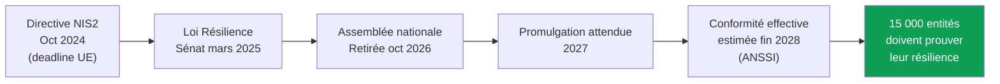
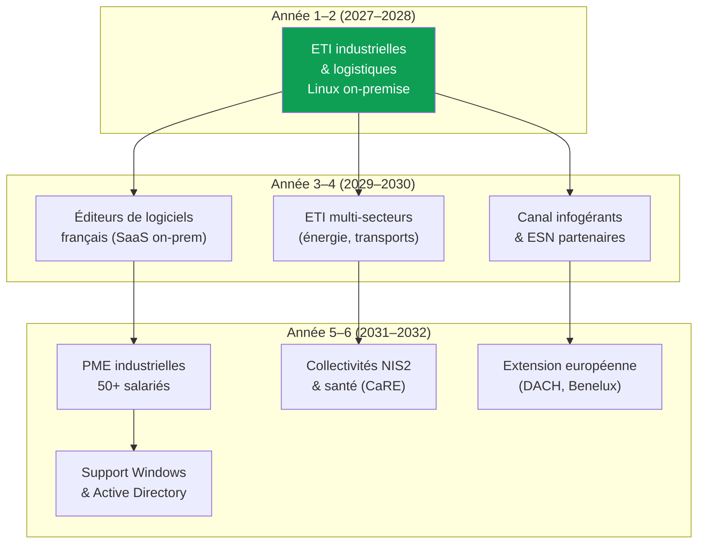
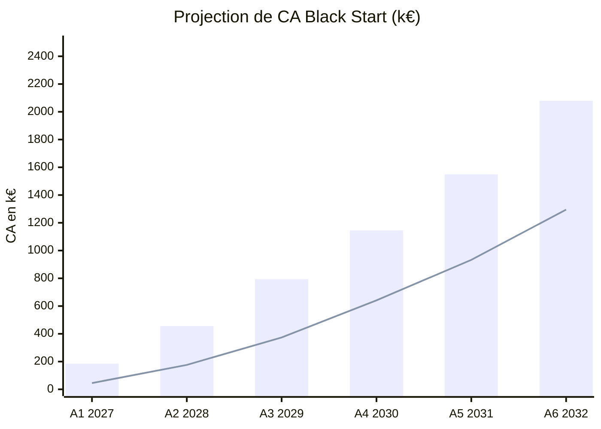
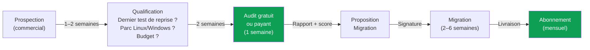

# Analyse de marché — Black Start
## Projection sur 6 ans (2027–2032)

> [!NOTE]
> Ce document distingue les données sourcées des hypothèses de l'équipe, signalées comme telles. Les hypothèses de prix et de pénétration sont prudentes.

---

## 1. Le marché adressable

### 1.1 TAM — Total Addressable Market

Black Start se positionne à l'intersection de trois marchés en forte croissance :

| Marché | Taille | Croissance annuelle | Source |
|---|---|---|---|
| **Disaster Recovery as a Service** (monde) | 13,7 Md$ (2025) → 24,1 Md$ (2030) | 11,9 % | Mordor Intelligence (2025) ; les estimations 2030 des cabinets vont de 24 à 51 Md$ selon le périmètre |
| **Infrastructure as Code** (monde) | 1,3 Md$ (2025) → 6,9 Md$ (2034) | 20,3 % | Fortune Business Insights |
| **Cybersécurité** (France) | 9,1 Md$ (2025) | 11,1 % (2026–2031) | Mordor Intelligence |

**TAM France (sous-segment "résilience & reconstruction serveurs on-premise") :**

Toute entreprise française ayant des serveurs configurés à la main et un besoin de preuve de reprise.

- 6 800 ETI (ministère de l'Économie, 2022 ; 6 218 en 2021 selon l'Insee)
- ~1 500 collectivités et organismes visés par NIS2 (Sénat)

En ne retenant que les ETI et un panier Black Start moyen de 25 k€ par an (hypothèse de l'équipe : audit et migration la 1re année, puis abonnement) :

$$\text{TAM France} = 6\,800 \times 25\,\text{k€} \approx 170\,\text{M€/an}$$

### 1.2 SAM — Serviceable Addressable Market

**Cible primaire : ETI industrielles et logistiques françaises avec parc Linux on-premise.**

| Filtre | Données | Source |
|---|---|---|
| ETI industrielles | ~2 100 | Insee Première n° 2084 (déc. 2025), données 2023 |
| ETI transports/logistique | ~500 | Estimation : 7,4 % des effectifs des ETI sont dans les transports et l'entreposage (Insee, Ésane 2021), appliqués aux 6 800 ETI |
| **Sous-total ETI cibles** | **~2 600** | |
| Dont parc Linux significatif (hypothèse 40 %) | **~1 040** | Hypothèse de l'équipe |
| Panier annuel moyen (audit + migration la 1re année, puis abonnement) | **25 k€** | Hypothèse de l'équipe |

$$\text{SAM} = 1\,040 \times 25\,\text{k€} \approx 26\,\text{M€/an}$$

> [!IMPORTANT]
> Le SAM de 26 M€ est prudent : il exclut les PME industrielles, les collectivités NIS2, le secteur santé (programme CaRE, volet continuité et reprise doté de 45 M€) et les éditeurs de logiciels.

### 1.3 SOM — Serviceable Obtainable Market (Année 5)

Le SOM reprend le prévisionnel de la section 5 : 12 personnes en année 5, dont 3 commerciaux, 5 ingénieurs consultants et 3 développeurs de l'outil.

| Paramètre (année 5) | Hypothèse |
|---|---|
| Nouveaux clients (audit + migration) | 22 |
| Clients sous abonnement | 61 (~6 % des 1 040 ETI du SAM) |
| CA audit + migration (8 k€ + 2 serveurs à 10 k€) | 616 k€ |
| CA abonnement (3 applications à 500 €/mois) | 933 k€ |

$$\text{SOM année 5} = 616\,\text{k€} + 933\,\text{k€} \approx 1\,549\,\text{k€}$$

> Objectif jury : **≥ 700–800 k€ de CA en année 5**. Le SOM le dépasse avec 61 clients sous abonnement ; l'abonnement seul (933 k€) l'atteint.

---

## 2. Les moteurs de croissance (2027–2032)

### 2.1 Pression réglementaire — NIS2 / Loi Résilience



**Calendrier probable :**
- **2027** : Promulgation de la loi, décrets d'application, premières notifications à l'ANSSI
- **2028** : Conformité complète attendue — pic de demande d'audits de résilience
- **2029–2030** : Contrôles, sanctions (jusqu'à 10 M€ ou 2 % du CA mondial), renouvellements

**Impact sur Black Start :** NIS2 impose aux entités essentielles et importantes de prouver leur capacité de reprise — exactement ce que l'outil délivre. C'est un argument de vente secondaire (le déclencheur reste le risque métier), mais un accélérateur puissant.

### 2.2 Menace cyber croissante

| Indicateur | Valeur | Source |
|---|---|---|
| Coût moyen d'une cyberattaque (ETI) | **13 M€** | ANSSI/CLUSIF via Sénat |
| Coût moyen d'une cyberattaque (PME) | **466 k€** | ANSSI/CLUSIF via Sénat |
| Victimes de rançongiciel dont l'attaquant a visé les sauvegardes | **94 %** (dont 57 % avec succès) | Sophos, *The Impact of Compromised Backups on Ransomware Outcomes* (enquête début 2024, 2 974 répondants) |
| Victimes rétablies en une semaine | **26 %** si les sauvegardes sont touchées, **46 %** sinon | Sophos, même étude |
| Coût médian de reprise | **3 M$** si les sauvegardes sont touchées, **375 k$** sinon | Sophos, même étude |
| Organisations attaquées récupérant plus de 90 % de leurs données | **10 %** (57 % en récupèrent moins de la moitié) | Veeam, *Ransomware Trends Report* (avril 2025, 1 300 organisations) |

→ Le coût de *ne rien faire* dépasse largement le coût d'un audit Black Start.

### 2.3 Des équipes informatiques réduites

Une ETI a un petit service informatique : la connaissance des serveurs tient souvent à quelques personnes. L'outil fait la collecte, le classement et la reconstruction ; l'ingénieur Black Start supervise et l'admin du client tranche les seuls inconnus (5 sur 176 écarts sur notre banc). Le client n'a pas à recruter pour prouver sa reprise.

### 2.4 Tendance "Infrastructure as Code" pour le on-premise

Le marché IaC croît à 20–25 %/an mais reste concentré sur le cloud (Terraform, CloudFormation). Le on-premise et l'intérieur des VM sont un angle mort :

| Segment | Bien couvert | Mal couvert |
|---|---|---|
| Cloud public (AWS, GCP, Azure) | ✓ Terraform, Pulumi | — |
| Kubernetes / conteneurs | ✓ Helm, ArgoCD | — |
| **VM on-premise Linux** | — | **✓ Black Start** |
| Contenu réel des serveurs | — | **✓ Black Start** |
| Preuve métier de bout en bout | — | **✓ Black Start** |

---

## 3. Segmentation et expansion progressive



### Détail par segment

| Phase | Segment | Taille estimée | Panier moyen | Justification |
|---|---|---|---|---|
| **1–2** | ETI industrielles/logistiques (Linux) | ~1 040 | 25–40 k€ la 1re année | Démo logistique, besoin immédiat, budget identifiable |
| **3–4** | Éditeurs de logiciels FR | ~300–500 | 20–30 k€ | Parc Linux natif, sensibles à l'IaC |
| **3–4** | Canal infogérants | ~50 ESN partenaires | Commission 20 % | Effet de levier commercial, accès aux PME |
| **5–6** | PME industrielles 50+ | ~12 000 (estimation de l'équipe) | 10–15 k€ | Volume, offre packagée, via infogérants |
| **5–6** | Collectivités NIS2 | ~1 500 | 15–25 k€ | Obligation réglementaire, marchés publics |
| **5–6** | Extension Windows/AD | Multiplicateur ×3 | +30 % prix | Couverture du parc réel des ETI |

---

## 4. Analyse concurrentielle approfondie

### 4.1 Cartographie des acteurs

| Acteur | Type | Levée / Taille | Forces | Faiblesses vs Black Start |
|---|---|---|---|---|
| **Veeam** | Éditeur backup | 1,7 Md$ de revenus récurrents (sept. 2024), valorisé 15 Md$ | Leader restauration, large base installée | Pas d'audit du contenu, pas de reconstruction depuis le code, pas de preuve métier |
| **Firefly** | Startup IaC cloud | $23 M (2024) | Codification cloud, bonne tech | Cloud-only, pas de on-premise, pas de preuve métier |
| **ControlMonkey** | Startup IaC cloud | $7 M seed (2025) | Terraform automatisé | Cloud-only, pas d'audit du contenu des VM |
| **formae** | Open source IaC | Early stage | Découverte de l'existant | Généraliste, pas de preuve de bout en bout |
| **VMShift (Mechanized AI)** | Startup VM→conteneurs | Seed | Conversion VM | Objectif différent (conteneurisation, pas résilience) |
| **ESN / Cabinets PRA** | Services | CA variable | Connaissance client, présence terrain | Manuel, lent, cher, pas reproductible |

### 4.2 Positionnement unique de Black Start

```
                    Automatisé + IA
                         ▲
                         │
           Firefly  ●    │    ● BLACK START
        ControlMonkey ●  │
                         │
    Cloud ◄──────────────┼──────────────► On-premise
                         │
                    ●    │    ● ESN / Cabinets
                  Veeam  │
                         │
                         ▼
                    Manuel / humain
```

**Avantage concurrentiel défendable :**
1. **L'outil** : collecte déterministe + classement IA + génération Ansible + sandbox + preuve métier = un cycle complet qu'aucun concurrent ne couvre de bout en bout
2. **Le modèle local** : les données ne quittent jamais l'infra du client (Qwen 3.6 35B en local sur CPU, modèle interchangeable) — argument souveraineté
3. **La preuve** : pas un rapport théorique, mais une VM reconstruite qui passe les tests métier avec un chrono mesuré

---

## 5. Projection financière sur 6 ans

### 5.1 Hypothèses de pricing

| Offre | Prix unitaire | Récurrence |
|---|---|---|
| **Audit** (5–10 apps, 1 semaine) | 8 000 – 12 000 € | Ponctuel (porte d'entrée) |
| **Migration** (reconstruction des VM critiques) | 10 000 – 15 000 € par VM | Forfait |
| **Abonnement** (détection de dérive, test de reprise régulier) | 500 – 900 € par mois et par application | MRR |

Prix revus le 7 novembre 2026 (anciens tarifs : audit 15–25 k€, migration 30–60 k€ par VM, abonnement 2–5 k€ par mois) : ce sont les plus bas qui couvrent le plan d'embauche de la section 5.4.

Le prévisionnel retient le bas des fourchettes : audit à 8 k€, **deux serveurs migrés** (2 × 10 k€) et **trois applications sous abonnement** (3 × 500 €/mois) par client. Un nouveau client commence son abonnement en milieu d'année ; 10 % des clients partent chaque année.

**Panier de la première année :** audit (8 k€) + migration (20 k€) = **28 k€**, puis 18 k€ par an d'abonnement.

### 5.2 Prévisionnel de CA

| | **A1 (2027)** | **A2 (2028)** | **A3 (2029)** | **A4 (2030)** | **A5 (2031)** | **A6 (2032)** |
|---|---|---|---|---|---|---|
| **Nouveaux clients** | 5 | 10 | 15 | 18 | 22 | 28 |
| **Clients en portefeuille (abo)** | 5 | 14 | 28 | 43 | 61 | 83 |
| **CA Audit** | 40 k€ | 80 k€ | 120 k€ | 144 k€ | 176 k€ | 224 k€ |
| **CA Migration** | 100 k€ | 200 k€ | 300 k€ | 360 k€ | 440 k€ | 560 k€ |
| **CA Abonnement (MRR)** | 45 k€ | 176 k€ | 374 k€ | 641 k€ | 933 k€ | 1 295 k€ |
| **CA Total** | **185 k€** | **456 k€** | **794 k€** | **1 145 k€** | **1 549 k€** | **2 079 k€** |



> [!TIP]
> La ligne verte représente le **MRR (abonnements)**, qui pèse la moitié du CA dès l'année 4. C'est le signal de scalabilité pour les investisseurs.

### 5.3 Structure de coûts et rentabilité

| Poste | A1 | A2 | A3 | A4 | A5 | A6 |
|---|---|---|---|---|---|---|
| **Salaires chargés** (60 k€ par personne en A1, puis 70 à 80 k€) | 300 k€ | 350 k€ | 525 k€ | 720 k€ | 960 k€ | 1 200 k€ |
| **Infra / hébergement** | 10 k€ | 20 k€ | 35 k€ | 50 k€ | 65 k€ | 80 k€ |
| **Commercial / marketing** | 30 k€ | 60 k€ | 100 k€ | 130 k€ | 160 k€ | 190 k€ |
| **Divers (locaux, juridique, compta, déplacements)** | 20 k€ | 35 k€ | 50 k€ | 65 k€ | 80 k€ | 95 k€ |
| **Total charges** | **360 k€** | **465 k€** | **710 k€** | **965 k€** | **1 265 k€** | **1 565 k€** |
| **Résultat** | **−175 k€** | **−9 k€** | **+84 k€** | **+180 k€** | **+284 k€** | **+514 k€** |
| **Résultat cumulé** | −175 k€ | −184 k€ | −100 k€ | +80 k€ | +364 k€ | +878 k€ |
| **Marge nette** | −95 % | −2 % | 11 % | 16 % | 18 % | 25 % |

Rentable dès l'année 3, pertes rattrapées en année 4.

### 5.4 Effectifs prévisionnels

| Rôle | A1 | A2 | A3 | A4 | A5 | A6 |
|---|---|---|---|---|---|---|
| Fondateur / ingénieur principal | 1 | 1 | 1 | 1 | 1 | 1 |
| Commercial | 1 | 1 | 2 | 2 | 3 | 4 |
| Ingénieur(s) consultant(s) | 2 | 2 | 3 | 4 | 5 | 6 |
| Développeur outil | 1 | 1 | 1 | 2 | 3 | 4 |
| **Total** | **5** | **5** | **7** | **9** | **12** | **15** |

---

## 6. Stratégie Go-to-Market

### 6.1 Déclencheurs d'achat

| Déclencheur | Urgence | Budget déjà alloué ? |
|---|---|---|
| Incident récent (ransomware, panne) | 🔴 Très haute | Souvent oui (remédiation urgente) |
| Audit de cyberassurance / renouvellement | 🟠 Haute | Oui (prime en jeu) |
| Exigence NIS2 / audit réglementaire | 🟠 Haute | En cours d'allocation |
| Départ de l'admin système | 🟡 Moyenne | Rarement anticipé |
| Test de reprise annuel (volontaire) | 🟢 Basse | Variable |

### 6.2 Cycle de vente



**Durée du cycle :** 4–8 semaines du premier contact à la signature.

### 6.3 Canaux d'acquisition

| Phase | Canal | Coût d'acquisition estimé |
|---|---|---|
| **A1–A2** | Réseau direct (conférences cyber, FIC, IMT Alumni) | ~2 000 € |
| **A1–A2** | Contenu technique (blog, démos live, GitHub) | ~500 € |
| **A3–A4** | Partenariats infogérants (commission 20 %) | 0 € fixe |
| **A3–A4** | Inbound marketing (SEO "test de reprise", "NIS2 conformité") | ~1 500 € |
| **A5–A6** | Commercial outbound dédié + salons sectoriels | ~3 000 € |

**CAC moyen visé :** 2 000–3 000 € → **LTV/CAC > 10** (LTV abonnement sur 3 ans : 54 k€).

---

## 7. Risques et mitigations

| Risque | Probabilité | Impact | Mitigation |
|---|---|---|---|
| **Linux trop minoritaire chez les ETI** | Moyenne | Critique | Mesurer la part Linux dès les premiers audits ; pivoter vers les éditeurs de logiciels ou ajouter Windows dès A3 |
| **NIS2 encore repoussée** | Moyenne | Modéré | Ne pas vendre NIS2 seul ; le déclencheur reste le risque métier |
| **Concurrent cloud descend vers le on-premise** | Faible | Élevé | Avancer vite sur la preuve métier (barrière technique) ; breveter le processus |
| **Difficulté à recruter des ingénieurs** | Haute | Modéré | L'outil réduit le besoin humain ; recruter dans le réseau IMT |
| **Cycle de vente ETI trop long** | Moyenne | Modéré | Audit gratuit comme porte d'entrée ; passer par les infogérants |
| **Le client n'a personne pour relire les MR** | Moyenne | Modéré | Offre "clé en main" avec relecture par l'ingénieur Black Start |

---

## 8. Stratégie de financement

| Phase | Besoin | Source | Usage |
|---|---|---|---|
| **Pré-seed (2027)** | 150–250 k€ | Bpifrance (bourse French Tech), concours i-Lab, love money | Finaliser l'outil, premiers clients pilotes, pertes des années 1 et 2 |
| **Seed (fin 2027 – 2028)** | 500 k€ – 1 M€ | VC spécialisés cyber (Auriga, Kima, Alven), subventions France 2030 | 3e consultant et 2e commercial (A3), 2e développeur de l'outil (A4), marketing |
| **Series A (2030)** | 3–5 M€ | VC growth | Scaling commercial (3 commerciaux), R&D Windows/AD, expansion DACH |

> [!TIP]
> **Pourquoi lever ?** Le pré-seed couvre les pertes des années 1 et 2 (−184 k€ cumulés) : les 5 fondateurs sont salariés dès le départ, avant que l'abonnement ne monte. L'activité devient rentable en année 3 et les pertes sont rattrapées en année 4. Ensuite, le prévisionnel recrute au rythme du chiffre d'affaires, donc lentement. La levée sert à prendre de l'avance : Windows et Active Directory prêts avant la conformité NIS2 attendue fin 2028, des recrutements avant la demande, et la trésorerie des projets payés jusqu'à 60 jours après livraison.

---

## 9. Synthèse : pourquoi le timing est bon

| Signal | Situation actuelle |
|---|---|
| **Réglementation** | NIS2 non transposée → promulgation attendue 2027 → conformité 2028. Fenêtre de 2 ans pour se positionner avant le pic de demande. |
| **Menace** | 94 % des victimes de rançongiciel voient leurs sauvegardes visées (Sophos, 2024), 13 M€ de coût moyen déclaré pour une ETI. Le besoin est tangible et croissant. |
| **Concurrence** | Le créneau "audit + reconstruction + preuve métier sur VM on-premise" est un trou dans le marché. Les acteurs cloud ne descendent pas, les ESN n'automatisent pas. |
| **Technologie** | Un modèle local (Qwen 3.6 35B, sur CPU, sans GPU) tourne sur un serveur existant et formule en 68 à 69 s les questions à poser sur les éléments inconnus, sans envoyer les données au cloud. La décision reste humaine : le classement et le code Ansible sont produits par des règles déterministes. |
| **Marché DRaaS** | 16–18 % de CAGR en Europe. Le marché IaC croît à 20–25 %. Black Start surfe sur les deux tendances. |

> [!IMPORTANT]
> **Objectif jury : 700–800 k€ de CA en année 5.**
> Notre projection atteint **1 549 k€ en année 5** avec 61 clients en portefeuille, ce qui correspond à une pénétration de **~6 % du SAM** — un objectif réaliste pour une startup spécialisée.

---

*Données au 5 novembre 2026, prix et prévisionnel revus le 7 novembre 2026. Les sources sont citées dans chaque section ; les prix et les taux de pénétration sont des hypothèses de l'équipe.*
